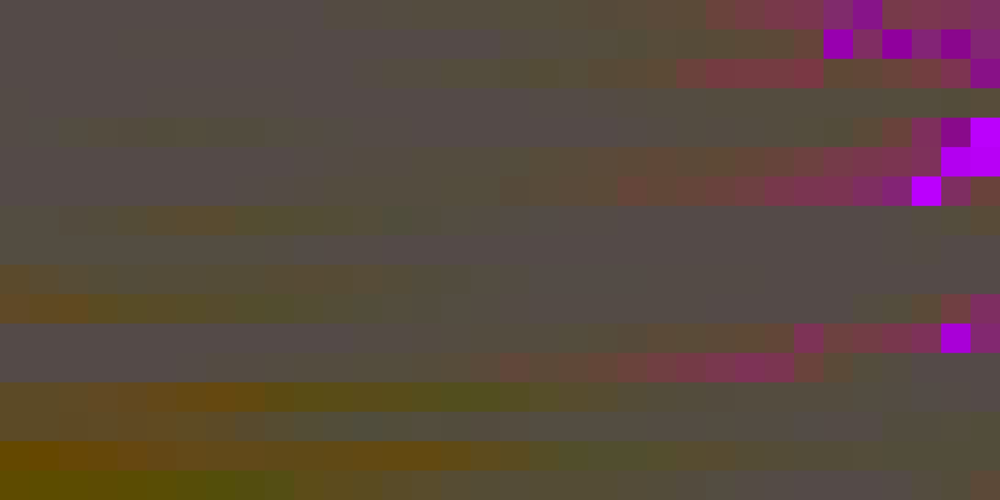

# lowcost-hsi — Imagen hiperespectral de bajo costo

Escáner hiperespectral construido con un microespectrómetro **Hamamatsu C12880MA**
(288 canales, ~340–850 nm), una **Raspberry Pi** y una **CNC GRBL** que recorre la
muestra punto a punto. Cada punto de la grilla produce un espectro completo; al
juntarlos se obtiene un cubo hiperespectral que se reconstruye como imagen y se
prepara para aprendizaje automático.

Proyecto de tesis de Ingeniería de Sistemas y Computación (Universidad Tecnológica
de Panamá).



---

## Qué hace

- **Adquisición:** driver del C12880MA sobre Raspberry Pi + ADC ADS1115 con
  sustracción de oscuridad, detección de saturación por píxel y promedio de
  acumulaciones.
- **Escaneo por grilla:** la CNC recorre la muestra en serpentina y en cada punto
  se captura y guarda el espectro.
- **Reconstrucción:** cada espectro se convierte a color visible con las funciones
  CIE 1931 → sRGB para obtener una imagen de la muestra.
- **Etiquetado manual:** selección de píxeles o zonas sobre la imagen para asignar
  niveles definidos por el usuario (verdad de campo para entrenar modelos).
- **Preprocesamiento para ML:** pipeline componible implementado en NumPy puro.
- **Panel web:** interfaz NiceGUI para controlar el escaneo, ver el espectro en
  vivo, revisar escaneos y registrar temperatura/humedad (ESP8266 + DHT11).

## Pipeline de preprocesamiento

Adapta el pipeline de *"Evaluation of fungal diseases using image analysis coupled
to spectroscopic technology"* (Int. J. Comput. Intell. Syst., 2018) a un
espectrómetro puntual:

| Paso | Técnica | Función |
|---|---|---|
| 1 | Corrección blanco/negro | `white_dark_correction()` |
| 2 | Suavizado Savitzky-Golay (2.º grado) | `smooth_profiles()` |
| 3 | Eliminación de perfiles anómalos (mediana ± kσ) | `remove_outlier_profiles()` |
| 4 | Verificación de redundancia (Bartlett, KMO) | `bartlett_sphericity()`, `kmo()` |
| 5 | Reducción de dimensionalidad (PCA por SVD) | `pca()` |

Todo está escrito a mano en NumPy, sin scipy ni scikit-learn.

```bash
python3 preprocessing.py --demo --plot pca.png          # datos sintéticos
python3 preprocessing.py --captures-dir scans/<escaneo>  # datos reales
```

## Arquitectura

```
┌──────────────────────┐        REST / HTTP        ┌────────────────────────────┐
│  Panel (UI)          │  ──────────────────────▶  │  Backend (rpi_server.py)   │
│  run_ui.py · NiceGUI │        puerto 8000        │  · Sensor C12880MA         │
│  navegador :8080     │  ◀──────────────────────  │  · CNC GRBL (serial USB)   │
│  (Mac / PC / la Pi)  │      estado · imágenes    │  (Raspberry Pi)            │
└──────────────────────┘                           └────────────────────────────┘
```

| Ruta | Contenido |
|---|---|
| `spectral_core.py` | Núcleo compartido: calibración de longitudes de onda, CIE 1931, sRGB, lectura de CSV |
| `preprocessing.py` | Pipeline de preprocesamiento (pasos 1–5) |
| `labeling.py` | Lógica de etiquetado manual de píxeles |
| `pi4_hama.py`, `Sensor/` | Drivers del espectrómetro (patrón Strategy) |
| `rpi_server.py` | API REST con FastAPI que corre en la Raspberry Pi |
| `ui/`, `run_ui.py` | Panel web NiceGUI |
| `tests/` | Pruebas del núcleo, el pipeline y el etiquetado |
| `docs/` | Puesta en marcha, diagnóstico de hardware y plan de mejoras |

## Instalación

```bash
python3 -m venv .venv && source .venv/bin/activate

pip install .            # núcleo (solo numpy)
pip install '.[viz]'     # + gráficas
pip install '.[ui]'      # + panel web
pip install '.[server]'  # + backend REST
pip install '.[rpi]'     # + GPIO/ADC (solo en Raspberry Pi)
```

Arranque:

```bash
# En la Raspberry Pi
uvicorn rpi_server:app --host 0.0.0.0 --port 8000

# En la Mac/PC (ajusta rpi_url en scanner_config.json)
python run_ui.py
```

La guía completa está en [`docs/inicio.md`](docs/inicio.md).

## Pruebas

```bash
pip install pytest
python3 -m pytest
```

## Documentación técnica

- [`docs/adquisicion-hardware.md`](docs/adquisicion-hardware.md): diagnóstico del
  ADC (clipping, resolución efectiva, efecto en el PCA) y evaluación de
  alternativas de hardware.
- [`docs/mejoras/`](docs/mejoras/): refactorizaciones aplicadas (núcleo espectral
  único, pipeline componible, tests, configuración centralizada, logging,
  empaquetado).

## Créditos

- **Orlando Montenegro** ([@Ekkology](https://github.com/Ekkology)): desarrollo
  del sistema.
- **Mel Nielsen** ([@nielsen29](https://github.com/nielsen29)), coasesor de la tesis: cliente GRBL
  inicial para el movimiento de la CNC, en el repositorio original del proyecto.

## Licencia

MIT. Ver [`LICENSE`](LICENSE).
